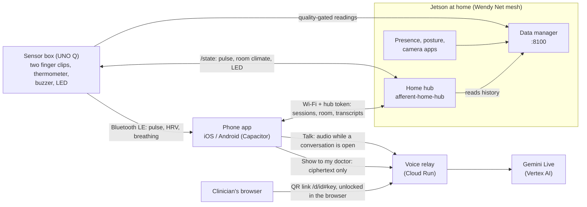

# Afferent

Home support after TMS treatment for depression. Junction 2026, Aalto "Beyond the Clinic".

## What Afferent is

Afferent is for people who have had TMS (transcranial magnetic stimulation) for depression and are back at
home between and after their treatment sessions. A calm phone app offers a short, wordless session each
morning (or a wind-down at night): kindle a lantern, rest a moment, play two minutes of gentle games. A
small bedside sensor box with two finger clips reads pulse, heart-rate variability and breathing, and the
games, the light and the music respond to the body as it is that day. The measurements stay at home on a
small hub, and the patient decides when to show a summary to their clinic.

> Research prototype. Not a CE-marked medical device. Not for clinical use. Supportive, not a treatment.
> All patient data in the demo is simulated.

[`STATUS.md`](STATUS.md) is the short list of what exists and the rules the code follows.

## How it works



- **Phone app** (`demo/` web layer, `ios/App`, `android/`): the morning session, the patient's week, the
  check-in, Talk, and "Show to my doctor".
- **Sensor box** (`uno-q/modulino-hub`): an Arduino UNO Q. The STM32 samples the clips; the Linux side fuses
  them, advertises "Afferent Finger" over Bluetooth, serves `/state` on the mesh and pushes measured
  readings to the data manager. Details: [`uno-q/SENSORS.md`](uno-q/SENSORS.md).
- **Home hub** (`hub/`, deployed by `jetson/home_hub`): sessions, analytics, the week view, the shared
  dashboard, Talk transcripts and the daily wellbeing read. It uses the real UNO Q as its bedside unit.
  Every route except `/api/health` needs the hub token. [docs/home-hub.md](docs/home-hub.md).
- **Data manager** (`jetson/data_manager`): one SQLite store on the Jetson for every sensor (finger clips,
  room, presence, posture), with daily aggregates and baselines. [API](jetson/data_manager/API.md).
- **The clinic** gets nothing live. On "Show to my doctor" the phone encrypts the dashboard, uploads only
  ciphertext to the relay and shows a QR code for `https://<relay>/d/<id>#<key>`; the key after `#` never
  leaves the browser, and the link ends after 7 days or when the patient takes it back. Without a relay the
  home hub serves it on the home network only. [docs/handover.md](docs/handover.md).
- **Voice relay** (`voice-relay/`, Cloud Run): holds the cloud credentials for Talk, the voice companion,
  and keeps the locked dashboards. [`voice-relay/README.md`](voice-relay/README.md).
- **Other work** on the same mesh: home presence from Wi-Fi and Bluetooth (`jetson/presence`), posture and
  movement markers (`posture-analysis/`), speech drift from Talk transcripts (`Transcription_analyzer/`),
  the Jetson camera app (`jetson/vision`). These feed the data manager; [docs/boards.md](docs/boards.md).

## What the app does

**A session.** Hold to kindle the lantern → a 6 s rest with the lantern (resting pulse, eye and blink
baselines) → a start-mood check-in → a short reaction round → the Fork (an effort choice) → about two
minutes of games, with the Lanterns task among them → dawn → the end sheet with the end mood. Greetings
follow the time of day, instructions stay until the first touch, and waiting at the dots between games
("Tap the light to go on") does not use up play time. A soft loading screen shows only while the art and
the first frame load.

**It responds to the body**, from the finger clips or a trusted camera pulse, always against the person's
own values:

- **Heartbeat:** the fire beats in a lub-dub at the real pulse, with stronger first beats and a ring of
  light when a pulse appears. With no reading it only breathes; it never beats on a guess.
- **Calm biofeedback:** in calm moments the aurora and the glow grow as breathing nears 6 a minute and as
  HRV rises above the session's own start value. Visual only; nothing is recorded. Breathing comes from the
  finger clips or the phone camera, whichever is clearer right now, and says which.
- **Games by state:** stressed (pulse up, HRV down or faster breathing) → calm breathing games; energised
  (pulse up, HRV steady, calm breathing) → puzzles; tired eyes by day → gentle wake-up games; tired at
  night → wind-down. A new state must hold for 3 s before the games change.
- **Games by what the face did** (TrueDepth camera, only where the pulse is near rest, low or missing and
  the eyes are not tired): smiling clearly more than the session's own share ("Smiling") → puzzles; much
  less facial movement than its own, with less smiling ("Face still") → livelier games and brighter light
  by day, the usual mix at night. The face numbers stay in the session document, never in a live message.
- **Live vitals overlay** (on by default, Settings › Sensors): pulse, HRV, breathing, the state and why
  ("Pulse up, HRV down → calmer breathing game"), plus the music and room rows. A missing reading says "no
  reading"; a simulated one is labelled.
- **Music that follows the heart:** generated in D, it starts at the real pulse and moves at most 1 bpm per
  12 s, never more than 10 bpm from the heart, leading gently towards calm. It needs a real pulse and never
  plays on simulated data.

**Haptics.** One vocabulary for the whole app (touch, tick, hit, bright, miss, land, rise, success,
complete, rhythm, heart, plus hold, drag and breath) through `demo/js/haptics.js`, on Core Haptics on iOS
and a matching Android plugin. Every control answers a tap with one touch or tick (`demo/js/gui/feel.js`).
Calm and night play softer. Settings has a Vibration switch and a Heartbeat touch level (Off, Soft, Medium,
Strong).

**Clip check.** Before a session: "Put a finger in each clip", a live check with a clear OK, and the camera
pulse as fallback when the clips give nothing. Only a real, fresh, quality-gated reading counts as OK. The
camera step coaches the distance ("Move a little closer", 20 to 45 cm) and the screen lights the face only as
much as it needs, then gives the brightness back (Settings › Sensors › Screen light for the camera).

**Heart Duel** (Settings › Sessions › Together). Two people, one clip each, both hearts beat live, and
whoever calms down first wins. Outside sessions only; nothing is saved or sent. A standalone Mac version
is in `fun/heart-duel`.

**Room climate.** The box's thermometer reaches the phone through the home hub. "Your signals" shows it,
and on a warm night (above 19.5 °C) one quiet line suggests a cooler room before the wind-down. The
patient's week and the shared dashboard show the nights.

**Talk.** A voice companion ("Hey, how are you feeling?" on the start screen) that listens more than it
asks. On a day the hub reads as bad, it gently suggests, once, talking to the doctor. Tap the lantern to turn the
microphone off (the phone's mic stops and nothing more is sent); tap it again to keep talking.

**Settings** opens on seven categories, each with its own page: Sound and feel, Sensors, Sessions,
Mornings and check-in (morning reminder, the PHQ-9 check-in every 14 days), Share with your clinic, Home
hub (address with a Paste button and a "Key missing" warning) and Help and about. A Developer section for
the team is hidden (tap the version line 7 times); its Face debug view shows what the face measures see, with
arrows out of the eyes. More in [docs/app.md](docs/app.md).

## Privacy and safety rules

These are in the code and its tests; please keep them.

- **Nothing is sent or streamed live to a clinician.** The patient hands data over when they choose to:
  the encrypted link, a printed code or a file. On the home hub the real patient is left out of the clinic
  view entirely.
- **Face images never leave the phone.** Camera frames, images, face meshes and raw blendshapes stay in the
  native layer and are not stored; only per-second numbers reach the web layer (plus gaze angles while the
  Developer face debug view is open). The session's face numbers stay on the home hub; a doctor sees only the
  weekly Expressiveness driver made from them (smiling and facial movement against the patient's own first weeks,
  [docs/handover.md](docs/handover.md#expressiveness-in-the-index)).
- **Quality and freshness gates.** A finger reading counts for 3 s. Quality below 0.3, or no quality, is not
  a measurement. Missing stays missing, never 0. The box holds a settling or doubled pulse until it is
  steady for 6 s and leaves out a noisy clip next to a clean one. The camera pulse is its own number, needs
  trust 40 or more and never drives the game.
- **Simulated data never counts as real.** It is never shown or stored as real (it is marked SIMULATED),
  and a session never mixes simulated and real pulse. Simulated sensors are off by default on phones and
  on in the browser demo.
- **Talk audio** goes to Google only while a conversation is open; the relay keeps no audio or text.
  Transcripts stay on the phone and the home hub.
- **Secrets stay out of the repo.** The hub token is kept in `~/.afferent/` files on the deploying Mac and
  reaches the phone only through its pairing link; the data manager token and the relay code come from the
  environment at deploy or build time.

**Crisis and support.** A "Talk to someone" button on every main screen opens the help numbers: Emergency
112, MIELI Crisis Helpline 09 2525 0111 (in Finnish, 24 h), Medical Helpline 116117, and the clinic's number
once the care team adds it, with the line "Afferent is not an emergency service and is not watched around
the clock." Answers to the PHQ-9 self-harm question lead to a support or crisis screen with the same
numbers. The lowest mood at both the start and the end of a session brings a gentle offer to talk. Opening
the help sheet leaves a talk request on the patient's own home hub (kept on the phone until the hub has
it). The voice companion's instructions always include the support button and 112.

## Hardware

- **Two finger clips:** PulseSensor-type optical sensors in 3D-printed fingertip holders (finger 1 on A1,
  finger 2 on A2). Clip 2 has a light-touch tip, and the holders are printed dark with high infill so room
  light cannot leak in. OpenSCAD source, S/M/L STLs and print notes in [`hardware/`](hardware/README.md).
- **Sensor box:** Arduino UNO Q with a Modulino Thermo (room temperature and humidity), a Modulino Buzzer
  and a KY-016 RGB LED (the "bedside light"). A Modulino Knob is supported but may be unplugged in the case.
  Without the box, Settings › Sensors › Sensor box off turns off everything that comes from it (clips, clip
  check, Heart Duel, room climate, bedside light and knob); sessions start at once and use what else there is
  (the camera pulse, a watch or strap) or the labelled simulator.
- **Jetson Orin Nano** with one camera (Logitech C920), running the home hub, the data manager and the
  presence, posture and camera apps.
- **No bed sensor.** The app's bed-presence switch is always off and never offered.

A low-estimate bill of materials (about €440 for a minimal setup) is in [`hardware/`](hardware/README.md).

## Run it

Needs Node 22+ and Python 3.12+. For the boards: the Wendy CLI
(`curl -fsSL https://install.wendy.dev/cli.sh | bash`, then `wendy auth login` with the team's org).

### Web demo in a browser

```sh
./start.sh --reset      # creates hub/.venv on first run, seeds the simulated demo roster
```

Then open the game at http://localhost:8000/app/, the patient view at `/app/patient.html?patient=anna` and
the clinic dashboard at `/clinic/`. Simulated sensors are on in the browser, so no hardware is needed.
`./start.sh --help` lists the options (a real UNO Q, no simulator, another port);
[docs/app.md](docs/app.md#the-demo-hub-and-developer-options) has the query options. An older snapshot of
the web app is hosted at https://afferent-demo.david-noel-vinu.workers.dev (not updated with every change).

### iPhone

```sh
npm install
npm run sync            # copies design/ into demo/, writes demo/js/voice-config.js, runs cap sync
npm run open            # Xcode: pick the iPhone, set your signing team, Run
```

From the command line, with your own team and bundle id (the committed id is `fi.junction.afferent`; the
override is not saved in the project):

```sh
xcodebuild -project ios/App/App.xcodeproj -scheme App -configuration Debug \
  -destination 'platform=iOS,name=<your iPhone>' -derivedDataPath build/ios -allowProvisioningUpdates \
  DEVELOPMENT_TEAM=<team id> PRODUCT_BUNDLE_IDENTIFIER=<your.bundle.id> build
xcrun devicectl device install app --device '<your iPhone>' build/ios/Build/Products/Debug-iphoneos/App.app
```

The app needs iOS 17. Developer Mode must be on, and the first launch asks to trust the developer
certificate. `npm run sync` also writes the voice relay settings (below), so run it with those variables
set, or the build has no relay.

### Android

With JDK 21 and the Android SDK on the path (Homebrew setup in [docs/app.md](docs/app.md#android)):

```sh
npm install
npm run build:android   # npm run sync, then ./gradlew assembleDebug
adb install -r android/app/build/outputs/apk/debug/app-debug.apk
```

`npm run open:android` opens Android Studio instead. CI (`.github/workflows/mobile-build.yml`) builds a
debug APK and an unsigned iOS simulator build on every pull request that touches the app.

### Sensor box (UNO Q)

`wendy run` compiles and flashes the STM32 sketch, then deploys the Linux app. The data manager's address
and token go in with `--env` on every deploy and are never written to `wendy.json` or the repo:

```sh
cd uno-q/modulino-hub
read -s DATA_MANAGER_TOKEN        # paste the token; not shown, not in the shell history
wendy run --device <uno-q> --detach --yes \
  --env "DATA_MANAGER_URL=http://<data manager address>:8100" \
  --env "DATA_MANAGER_TOKEN=$DATA_MANAGER_TOKEN"
```

`GET /state` has a `data_manager` block to check that readings arrive (`last_error` `HTTP 401` = wrong
token). More in [`uno-q/SENSORS.md`](uno-q/SENSORS.md#readings-to-the-data-manager-on-the-jetson).

### Home hub on the Jetson

The data manager already runs on the Jetson (mesh port 8100, token required); do not deploy a second copy.
Deploy the hub and pair:

```sh
WENDY_DEVICE=<jetson> jetson/home_hub/deploy.sh   # first deploy makes ~/.afferent/home-hub.token (mode 600)
wendy net forward 18000:18000 --device <jetson>  # keep running
jetson/home_hub/pair.sh                           # pairing link for a browser on this Mac
```

`deploy.sh` reads the data manager token from `~/.afferent/data-manager.token` (or
`AFFERENT_DATA_MANAGER_TOKEN`). The pairing link holds the hub token: open it, never paste it into a chat,
an issue or a commit.

For a phone on the same Wi-Fi as the Mac, keep the forward running and relay it on the Mac's Wi-Fi address:

```sh
IP=$(ipconfig getifaddr en0)      # the Mac's Wi-Fi address (en0 on most Macs)
socat TCP-LISTEN:8000,bind=$IP,fork,reuseaddr TCP:127.0.0.1:18000
jetson/home_hub/pair.sh $IP       # prints the Hub address; it must end in /k/<token>
```

In the app: Settings › Home hub › Paste, then Connect.

Without the Mac: the LAN door puts the hub on the Jetson's own Wi-Fi at port 8800 (the hub itself stays on
the mesh). With the Jetson on the phone's Wi-Fi:

```sh
WENDY_DEVICE=<jetson> jetson/home_hub/deploy.sh          # the hub announces itself on the mesh
WENDY_DEVICE=<jetson> jetson/home_hub/door/deploy.sh     # the door: port 8800, Bonjour _afferent-hub._tcp
WENDY_DEVICE=<jetson> jetson/home_hub/pair.sh --jetson   # Hub address <jetson-ip>:8800/k/<token>
```

In the app: Settings › Home hub › Find on this Wi-Fi (keeps the key it has), or Paste, then Connect.
Everything else (joining the Jetson to a Wi-Fi, networks that block Bonjour, USB hotspot instead of Wi-Fi,
the environment variables, real versus simulated patients) is in [docs/home-hub.md](docs/home-hub.md).

### Voice relay

The app reads the relay's address and access code from `demo/js/voice-config.js`, which git ignores. Write
it from the environment, never into a committed file:

```sh
VOICE_RELAY_URL=https://<relay>.run.app VOICE_RELAY_CODE=<access code> npm run voiceconfig   # or npm run sync
```

Or type both on the phone: Talk › Start talking. To deploy the relay (Google Cloud project with billing,
`gcloud` signed in), from `voice-relay/`:

```sh
gcloud run deploy afferent-voice --source . --region europe-north1 \
  --service-account afferent-voice@<project>.iam.gserviceaccount.com \
  --allow-unauthenticated --timeout 3600 --min-instances 1 --max-instances 1 \
  --set-env-vars RELAY_CODE=<access code>,GOOGLE_CLOUD_PROJECT=<project>,VERTEX_LOCATION=us-central1
```

Exactly one instance, because shared dashboards are kept in memory. First-time setup (APIs, service
account) and the checks are in [`voice-relay/README.md`](voice-relay/README.md#deploy-once-10-min).

## Tests

```sh
# Web app and clinic page (node only; voiceconfig once, keyboard.test.js loads its output)
npm run voiceconfig
for f in demo/tests/*.test.js hub/tests/*.test.js; do node "$f" > /dev/null || echo "FAIL $f"; done
# Hub (start.sh makes hub/.venv; the dev requirements add zeroconf for the mDNS tests)
hub/.venv/bin/pip install -r hub/requirements-dev.txt
(cd hub && .venv/bin/python -m pytest -q)
(cd hub && .venv/bin/python -m afferent_hub.analytics.validate)   # synthetic validation, rewrites its results
# Sensor box and the Jetson apps
(cd uno-q/modulino-hub && python3 -m unittest discover tests)
(cd jetson/data_manager && python3 -m unittest discover -s tests)
(cd jetson/presence && python3 -m unittest discover -s tests)
(cd jetson/hub && python3 -m unittest discover tests)
# Voice relay (a fake Vertex, no Google account needed)
(cd voice-relay && pip install -r requirements-dev.txt && pytest test_main.py)   # pinned versions
# Native
(cd ios/App/TeamTests && swift test)     # camera pulse estimator and gate, screen light
(cd ios/App/FaceCore && swift test)      # face measures
(cd ios/App/FingerTests && swift test)   # Bluetooth packet parser
(cd android && ./gradlew testDebugUnitTest)
(cd fun/heart-duel && node --test)
```

The reference iPhone app has its own tests (`ios/README.md`). `posture-analysis/` and
`Transcription_analyzer/` document theirs in their READMEs.

## Repo layout

| Folder | What |
|---|---|
| `demo/` | the phone app's web layer (Capacitor web root): game, patient view, tests in `demo/tests` |
| `ios/` | `ios/App`: the Capacitor iOS app and its native plugins; `ios/Afferent`: the native reference app |
| `android/` | the Capacitor Android app and its native plugins |
| `hub/` | FastAPI hub: API, analytics, clinic dashboard, bedside link, handover export |
| `jetson/` | Wendy apps for the Jetson: `home_hub` (deploys `hub/`), `data_manager`, `presence`, `vision`, `hub` |
| `uno-q/` | the sensor box app `modulino-hub` (STM32 sketch + Linux side) and `SENSORS.md` |
| `voice-relay/` | Cloud Run relay for Talk and the locked dashboards, with the doctor's viewer |
| `contracts/` | JSON schemas and fixtures shared by the app and the hub |
| `design/` | design tokens, fonts, icon and the final concept art |
| `art/` | the plans for the generated images and music (`generate.py`, `plan.json`, `music_plan.json`) |
| `hardware/` | printable finger clip holders and the bill of materials |
| `posture-analysis/` | posture, gait and expressivity markers from a camera, its controller and training |
| `Transcription_analyzer/` | speech-drift scoring of Talk transcripts |
| `fun/` | Heart Duel for the Mac |
| `tools/` | helper scripts: music import, clinic demo exports |
| `docs/` | longer write-ups (below) |
| `bibliography/` | references for the posture and expression work |

All repo content (code, comments, docs, commit messages) is in English.

## Further reading

- [docs/app.md](docs/app.md): sensors in the app, camera pulse, face measures, clip check, room climate,
  Android, developer options. [docs/handover.md](docs/handover.md): "Show to my doctor".
- [docs/home-hub.md](docs/home-hub.md): the hub on the Jetson, transcripts, the wellbeing read;
  [docs/decline_alert.md](docs/decline_alert.md): the personal decline alert.
- [docs/boards.md](docs/boards.md): the boards, the Jetson camera app, the patient's own health-data hub
  (`jetson/hub`), the reference iPhone app. [`uno-q/SENSORS.md`](uno-q/SENSORS.md): the sensor box's API.
- [`BUG_BURN_DOWN.md`](BUG_BURN_DOWN.md) and `docs/bugburn/`: the bug audit. The posture and expression work:
  [plan](docs/plan_posture_depression.md), [capture](docs/capture_plan.md),
  [review](docs/implementation_review.md), [training](docs/verda_training.md).

## Licenses and credits

- Code: [MIT](LICENSE). Sounds in `demo/audio/`: CC0 and public-domain recordings, each with source,
  author and changes in [`demo/audio/CREDITS.md`](demo/audio/CREDITS.md).
- Images and music tracks were generated for this project; the plans are in `art/` (the walk's
  birches and spruces in `art/plan.json`, finalised by `art/finalize_trees.py`; the earlier image plans on
  branch `art-v5`), and `tools/music_import.py` cuts and normalises the tracks.
- Fonts: Fraunces, Google Sans Flex, Jost and JetBrains Mono (SIL Open Font License; texts in
  `design/fonts/` and `demo/fonts/`), Material Symbols (Apache-2.0).
- Vendored: qrcode-generator, jsQR, fflate, noble-curves/hashes
  ([`demo/vendor/qr/LICENSES.md`](demo/vendor/qr/LICENSES.md)); MediaPipe Tasks Vision and its face
  landmarker model (Apache-2.0, [`demo/vendor/mediapipe/LICENSE`](demo/vendor/mediapipe/LICENSE)).
- The companion's listening design draws on Rogers and Farson
  ([references](voice-relay/README.md#listening-design-and-references)).
