<div align="center">


# Afferent

### A morning game that evolves with your vital signs,<br>and tells the clinic when to call, before the relapse.

Home support after TMS treatment for depression. Pulse, heart-rate variability and breathing reshape the game<br>
second by second; a hub keeps the data at home; the patient chooses when the clinic sees the early-warning dashboard.

**Junction 2026 · Aalto "Beyond the Clinic"**

[The adaptive game](#the-game-evolves-with-your-vital-signs) · [Why](#the-problem) · [How it works](#how-it-works) · [See it](#see-it) · [Clinic view](#what-the-clinic-sees) · [Privacy](#privacy-by-design) · [Under the hood](#under-the-hood) · [Run it](#run-it)

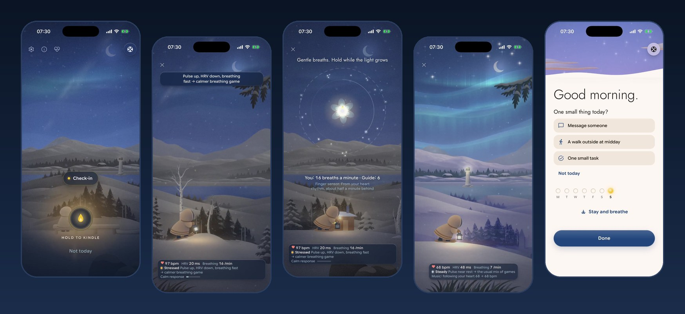

</div>

> Research prototype. Not a CE-marked medical device. Not for clinical use. Supportive, not a treatment.
> All patient data in the demo is simulated.

| What you get | In short |
|---|---|
| **A game that evolves with the body** | pulse, HRV and breathing choose the next game, the light, the haptics and the music tempo in real time, always against the person's own baseline |
| **A session a patient wants to do** | 2 minutes, wordless, 26 hand-painted mini-games, read by two €3 finger clips or the phone camera |
| **A clinic that sees trouble early** | a 10-driver early-warning index: in simulation, a check-in is suggested a median 13.5 days after relapse onset |
| **Data that stays home** | everything lives on a hub in the patient's home; the clinic gets an end-to-end encrypted summary only when the patient shows a QR code |
| **Real hardware, about €350** | phone app (iOS and Android), an Arduino UNO Q sensor box, a Jetson Orin Nano home hub, 3D-printed clips |
| **Built in one weekend** | 749 commits, 111 merged pull requests, about 120,000 lines of code and 150 test files, 13 to 15 November 2026 |

## The game evolves with your vital signs

This is the heart of Afferent. The session is not a fixed sequence: the finger clips (or a trusted camera
pulse) read the body continuously, and the game **changes while you play**. A rising pulse with falling HRV
turns the next game into slow breathing; a calm, steady heart opens the puzzles; the fire beats at the real
heartbeat and the music starts at the real pulse. Every decision is against the person's **own** values,
and the app says why on screen: *"Pulse up, HRV down, breathing fast → calmer breathing game"*.

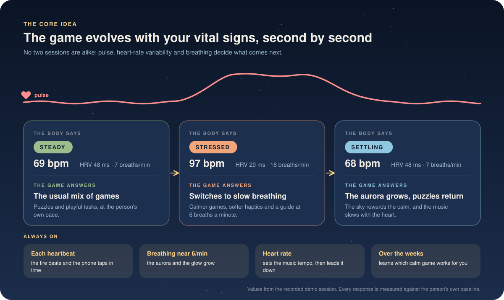

<table>
<tr>
<td width="270">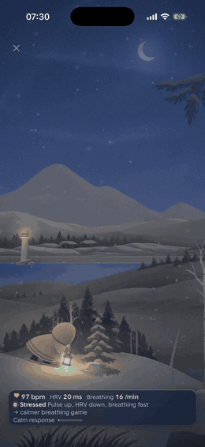</td>
<td>

| The body says | The app answers |
|---|---|
| Pulse up, HRV down, faster breathing | Calm breathing games |
| Pulse up, HRV steady, calm breathing | Puzzles (flow) |
| Tired eyes by day | Gentle wake-up games |
| Tired at night | Wind-down |
| Smiling clearly more than usual | Puzzles |
| Face unusually still | Livelier games, brighter light |
| A heartbeat appears | The fire beats lub-dub at the real pulse, with haptics |
| Breathing nears 6 a minute | The aurora and the glow grow |
| The heart rate itself | Music in D that starts at the pulse and leads it down, at most 1 bpm per 12 s |

With no reading the fire only breathes. It never beats on a guess.

</td>
</tr>
</table>


It also evolves **over weeks**: a Bayesian bandit learns which calm game settles this person's pulse best
(a median 11 sessions in simulation), and the same vital signs feed the early-warning index the clinic reads.

## The problem

TMS (transcranial magnetic stimulation) works for many people with depression, but the effect fades: in a
meta-analysis, about half of the responders had lost their response within a year
(Senova et al., *Brain Stimulation*, 2019). A booster session
helps most when it comes early. Yet once the treatment course ends, the patient goes home and the clinic
sees nothing until the next appointment. The relapse starts in exactly that gap.

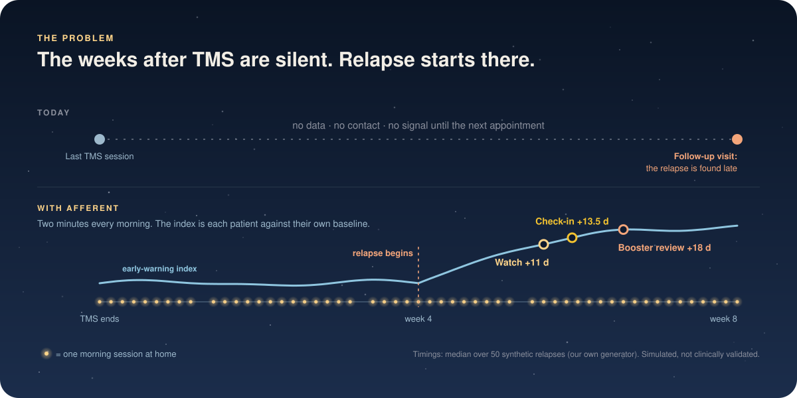

## How it works

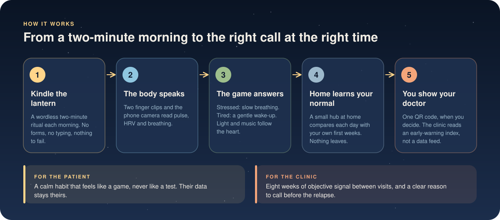

## See it

A morning session, recorded from the app (iPhone 17 Pro simulator, pulse fed as finger-clip frames).
Full takes are in [`videos/`](videos/README.md).

| Hold to kindle | "How are you this morning?" | A reaction round | The pulse rises: stressed |
|:---:|:---:|:---:|:---:|
| 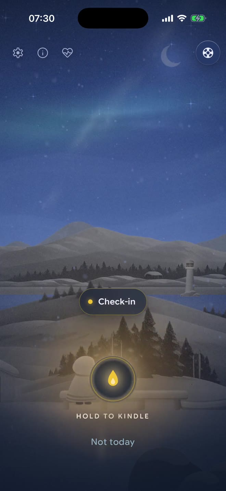 | 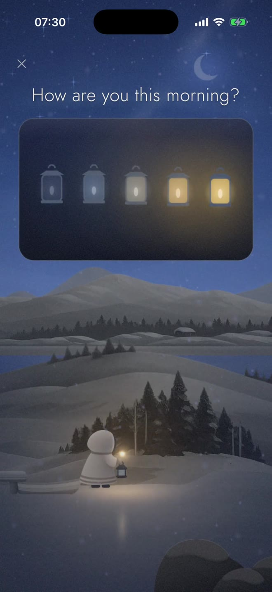 | 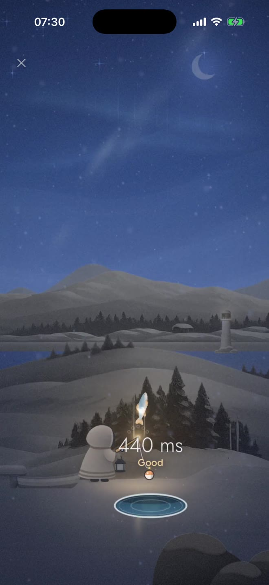 | 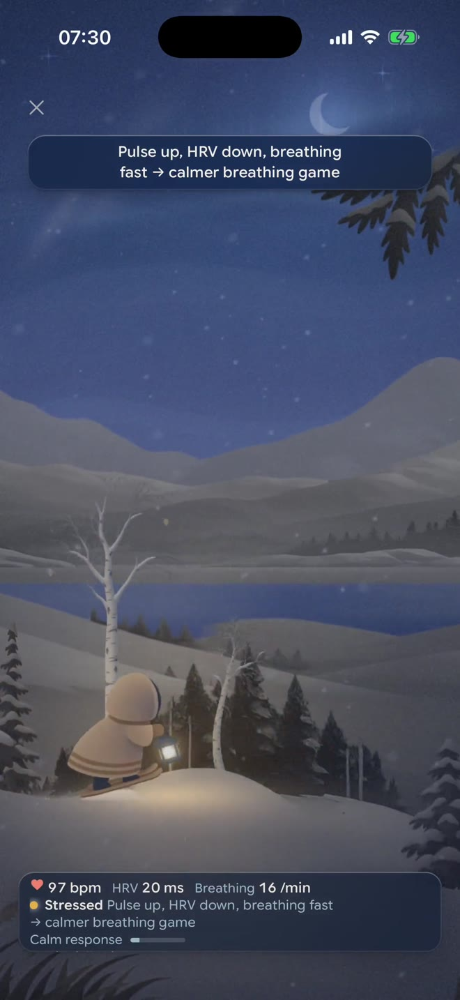 |
| One hold starts the day. No login, no menu. | The start mood, in one tap, no words. | Reaction time is one of the ten drivers. | The app sees it and says so, live. |

| The game answers with breathing | Two lanterns | The aurora grows as you calm | Dawn, and one small step |
|:---:|:---:|:---:|:---:|
| 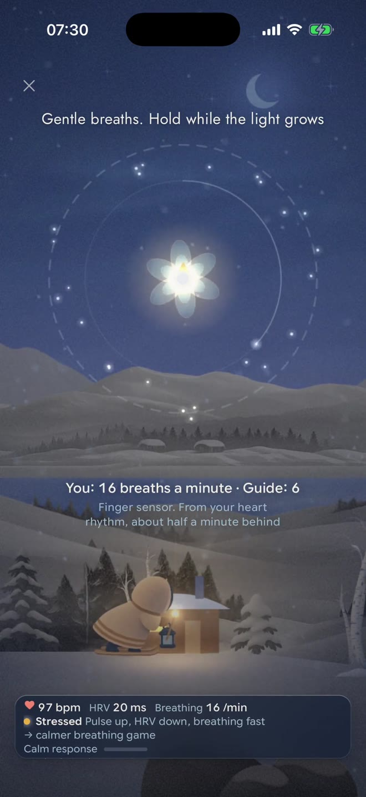 | 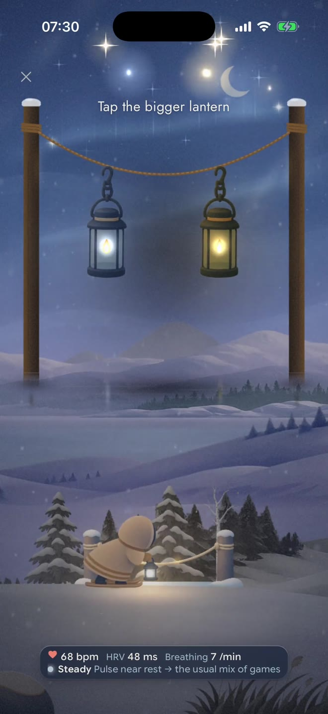 | 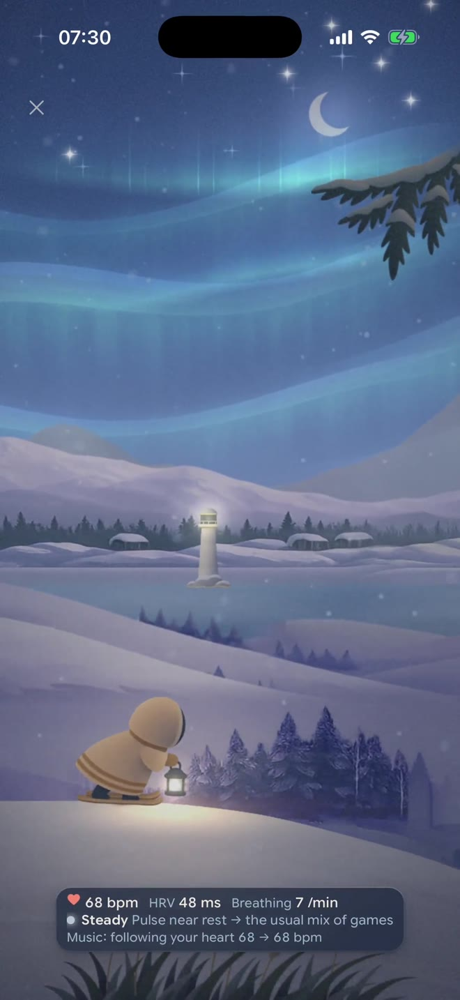 | 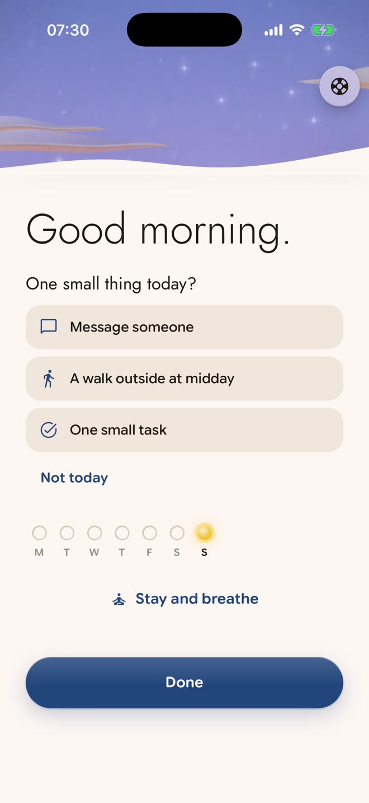 |
| Measured breathing, guided to 6 a minute. | "Tap the bigger lantern": a perception task. | Biofeedback: 68 bpm, HRV back up. | Behavioural activation: "Message someone". |

Around the session:

- **Talk.** A voice companion (Gemini Live) that listens more than it asks. On a day the hub reads as bad it
  suggests, once, talking to the doctor. Tap the lantern to mute the microphone.
- **The patient's week.** Lit mornings, layers that build up, bedroom climate at night, a PHQ-9 check-in
  every 14 days.
- **Heart Duel.** Two people, one clip each, whoever calms down first wins. Nothing is saved.
- **Crisis support on every main screen** (details [below](#crisis-and-support)).

| Your mornings | This week | Show to my doctor | The code | Heart Duel |
|:---:|:---:|:---:|:---:|:---:|
| 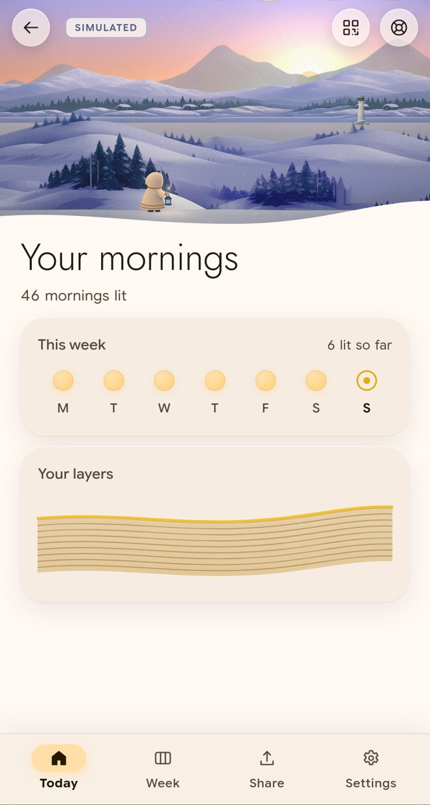 | 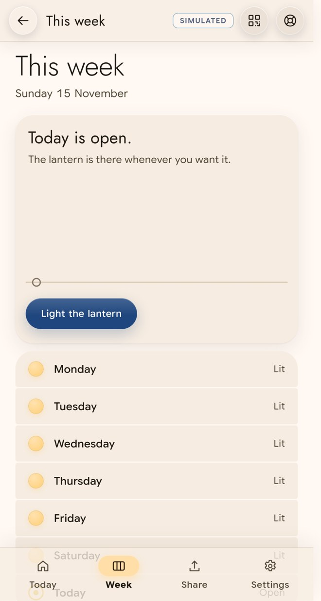 | 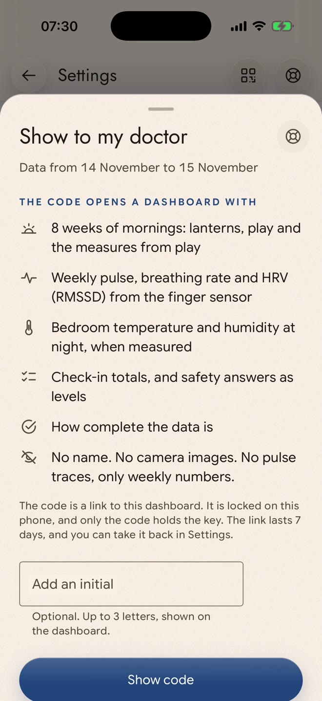 | 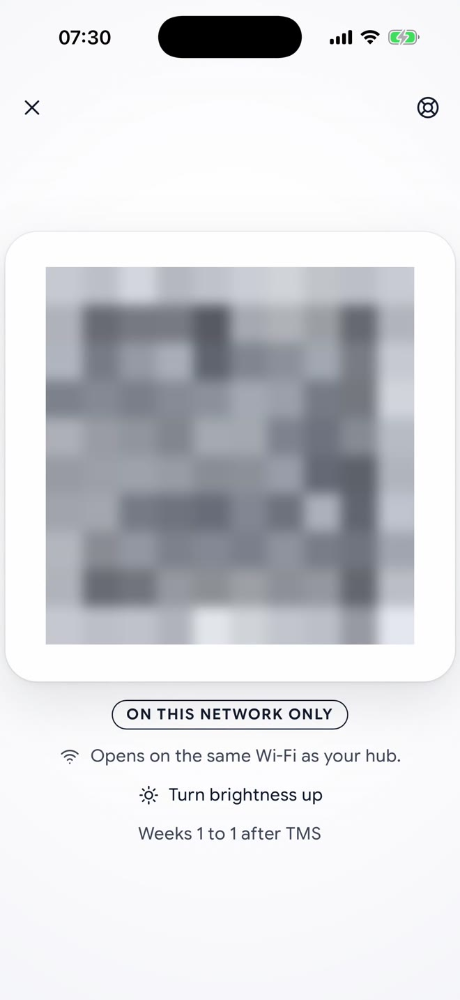 | 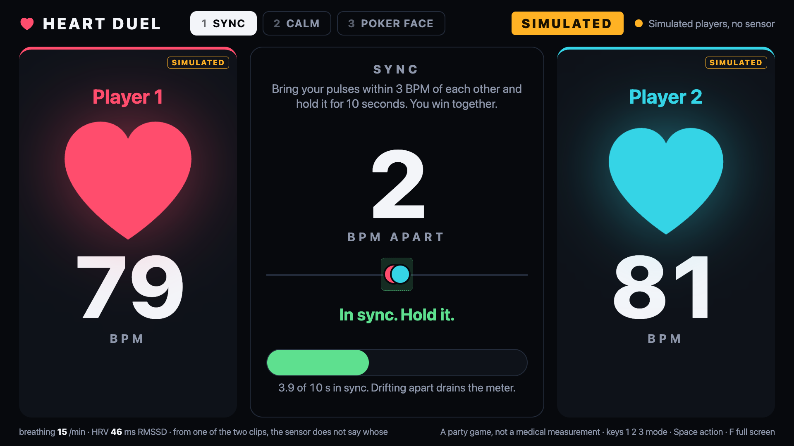 |

## What the clinic sees

Not a data feed. One page per patient, opened from the code the patient shows: a status, the reason for it,
and eight weeks of measures against that patient's own first two weeks after TMS.

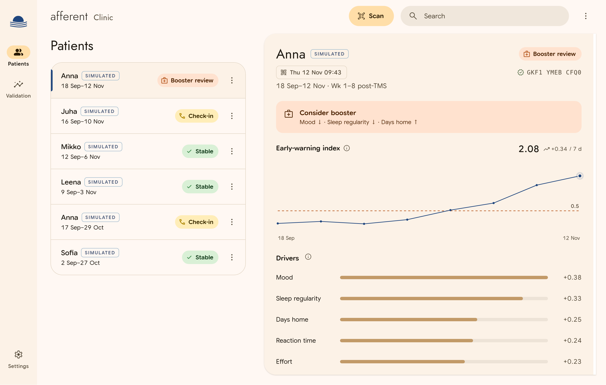

<table>
<tr>
<td width="50%">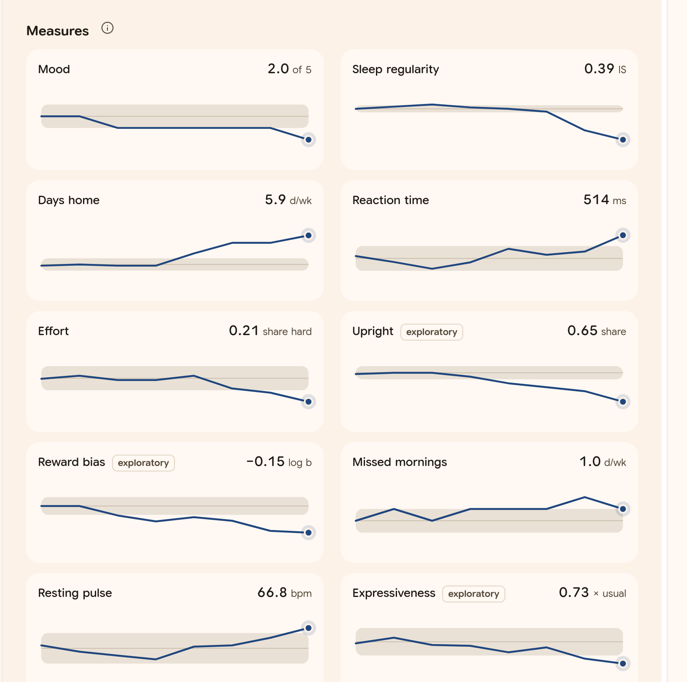</td>
<td width="50%">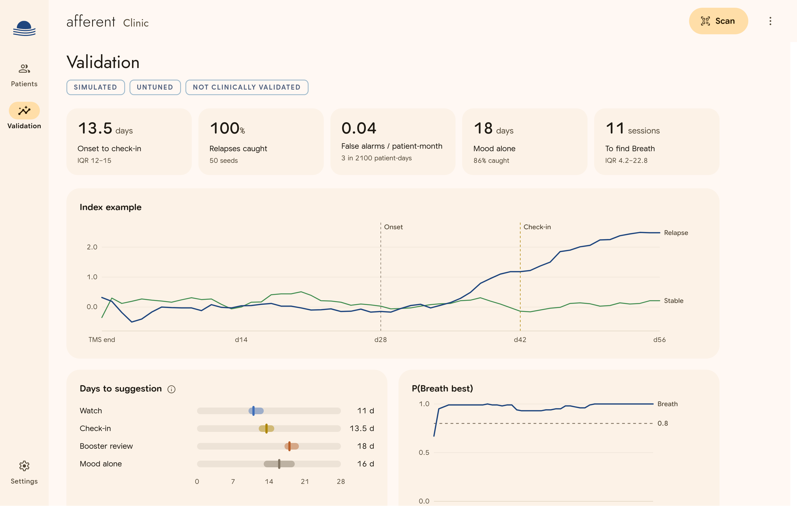</td>
</tr>
<tr>
<td><b>Ten drivers, one index.</b> Each measure is a robust z-score against the patient's own baseline; the weighted mean feeds a one-sided CUSUM with three thresholds: Watch, Check-in, Booster review.</td>
<td><b>A validation page inside the product.</b> The clinic sees how the index behaves, with its limits printed on top: simulated, untuned, not clinically validated.</td>
</tr>
</table>

**The early-warning index on 50 synthetic relapses and 50 stable controls**
(`python -m afferent_hub.analytics.validate`, results in
[`validation_results.json`](hub/afferent_hub/analytics/validation_results.json)):

| | Afferent index (10 drivers) | Mood check-in alone, same false-alarm rate |
|---|---:|---:|
| Relapses caught by day 55 | **100 %** | 86 % |
| Days from onset to the check-in flag (median) | **13.5** | 18 |
| False alarms per stable patient-month | **0.04** | 0.04 |

Before the check-in flag there is a Watch level at 11 days, and a Booster review at 18. No relapse was
flagged before its onset. These are synthetic patients from our own generator: the numbers show that the
method works end to end, not how it performs on real people.

## Privacy by design

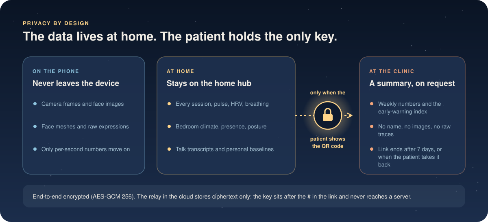

These rules are in the code and its tests; please keep them.

- **Nothing is sent or streamed live to a clinician.** The patient hands data over when they choose to:
  the encrypted link, a printed code or a file. On the home hub the real patient is left out of the clinic
  view entirely.
- **Face images never leave the phone.** Camera frames, images, face meshes and raw blendshapes stay in the
  native layer and are not stored; only per-second numbers reach the web layer (plus gaze angles while the
  Developer face debug view is open). The session's face numbers stay on the home hub; a doctor sees only the
  weekly Expressiveness driver made from them (smiling and facial movement against the patient's own first weeks,
  [docs/handover.md](docs/handover.md#expressiveness-in-the-index)).
- **Quality and freshness gates.** A finger reading counts for 3 s. Quality below 0.3, or no quality, is not
  a measurement. Missing stays missing, never 0. The box holds a settling or doubled pulse until it is
  steady for 6 s and leaves out a noisy clip next to a clean one. The camera pulse is its own number, needs
  trust 40 or more and never drives the game.
- **Simulated data never counts as real.** It is never shown or stored as real (it is marked SIMULATED),
  and a session never mixes simulated and real pulse. Simulated sensors are off by default on phones and
  on in the browser demo.
- **Talk audio** goes to Google only while a conversation is open; the relay keeps no audio or text.
  Transcripts stay on the phone and the home hub.
- **Secrets stay out of the repo.** The hub token is kept in `~/.afferent/` files on the deploying Mac and
  reaches the phone only through its pairing link; the data manager token and the relay code come from the
  environment at deploy or build time.

### Crisis and support

A "Talk to someone" button on every main screen opens the help numbers: Emergency 112, MIELI Crisis Helpline
09 2525 0111 (in Finnish, 24 h), Medical Helpline 116117, and the clinic's number once the care team adds
it, with the line "Afferent is not an emergency service and is not watched around the clock." Answers to the
PHQ-9 self-harm question lead to a support or crisis screen with the same numbers. The lowest mood at both
the start and the end of a session brings a gentle offer to talk. Opening the help sheet leaves a talk
request on the patient's own home hub (kept on the phone until the hub has it). The voice companion's
instructions always include the support button and 112.

## Why it can work as a product

- **It covers the gap between visits with almost no clinic time.** The clinician reads a status and three reasons, not
  raw data, and acts only on Check-in or Booster review.
- **Adherence is the product.** A measurement nobody does is worth nothing, so the measurement is hidden in
  a two-minute game people come back to: painted art, haptics, music and a week of lit mornings.
- **Privacy is the sales argument, not a constraint.** No patient cloud, no live monitoring, no account. The
  only server ever holds ciphertext. That is an easy conversation with a patient and with a hospital's
  data protection officer.
- **Cheap, standard hardware.** About €350 for the minimal home setup ([bill of materials](hardware/README.md)),
  and the app degrades gracefully: without the sensor box it runs on the camera pulse, a watch or a strap.
- **Personal baselines, not population norms.** Every number is the patient against their own first two
  weeks after TMS, which is what makes cheap sensors usable.
- **More channels are already wired in.** Home presence from Wi-Fi and Bluetooth (outings, visits), posture
  and movement from one camera, and speech drift from Talk transcripts scored by a local LLM on the Jetson
  all feed the same store and the same decline alert.

What it still needs is said plainly on the validation page: tuning and validation on real patients.

## Under the hood

Five runtimes, one system: a Capacitor web layer with native Swift and Kotlin plugins, an STM32 sketch, two
Linux edge boards on a mesh, and one small cloud relay.

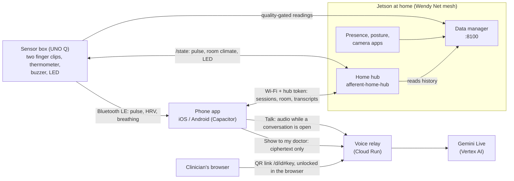

| Layer | What is in it |
|---|---|
| **Signal processing on a microcontroller** | The STM32 samples two optical clips; the Linux side fuses them into one pulse, per-finger pulse, HRV (RMSSD) and breathing derived from heart rhythm, with a quality score. A doubled or settling pulse is held until steady for 6 s, a noisy clip next to a clean one is dropped, and light leaking into the case is not a finger. Custom Bluetooth LE service, 7-byte frames. [`uno-q/SENSORS.md`](uno-q/SENSORS.md) |
| **Camera pulse and face measures, on device** | POS rPPG from the front camera inside the app's single ARKit face session, with distance coaching and a screen light that adapts. Smile share, facial movement, blinks and eye openness come out as numbers; frames never leave the native layer. [docs/app.md](docs/app.md) |
| **A game engine that reads physiology** | 26 mini-games in five modes (calm, flow, wake, fatigue, rest), WebGL shaders, a state machine with a 3 s hold before the mode changes, and a Bayesian bandit that learns which calm game settles this person's pulse best (a median 11 sessions in simulation). `demo/js/engine.js`, `hub/afferent_hub/analytics/bandit.py` |
| **Biofeedback you can feel and hear** | One haptic vocabulary on Core Haptics and a matching Android plugin; generated music that glides at most 1 bpm per 12 s and never more than 10 bpm from the heart. |
| **Analytics** | Ten drivers as robust z-scores against days 0 to 13, EWMA smoothing, one-sided CUSUM, three thresholds, plus a synthetic patient generator and a validation harness with a sensitivity sweep. `hub/afferent_hub/analytics/` |
| **Edge data platform** | One SQLite store on the Jetson for every sensor, with daily aggregates, trends and baseline deviations behind a token. [API](jetson/data_manager/API.md). A decline alert reads it and briefs the voice companion with facts, never raw values. [docs/decline_alert.md](docs/decline_alert.md) |
| **End-to-end encrypted handover** | AES-GCM under a fresh 256-bit key made on the phone; the relay stores ciphertext; the key travels only after `#` in the QR link; the viewer decrypts in a sandboxed frame; 7-day expiry and revocation. [docs/handover.md](docs/handover.md) |
| **Voice companion** | Gemini Live on Vertex AI through a Cloud Run relay that holds the credentials and keeps no audio or text. A listening design after Rogers and Farson. [`voice-relay/README.md`](voice-relay/README.md) |
| **Local LLM for speech drift** | Talk transcripts scored at night by an 8B-class model on the Jetson (llama.cpp), against the person's own baseline. [`Transcription_analyzer/`](Transcription_analyzer/README.md) |
| **Posture, movement, presence** | Camera markers of posture and gait ([plan](docs/plan_posture_depression.md), [bibliography](bibliography/bibliography.md)); home presence, outings and visits from Wi-Fi and Bluetooth (`jetson/presence`). |
| **Afferent Live** | A public read-only page of the real demo table, with "What would it do?" sliders that run the game's own decision code unchanged. [`live/README.md`](live/README.md) |
| **Shared contracts and CI** | JSON schemas for sessions, check-ins and daily data (`contracts/`); CI builds a debug APK and an iOS simulator build on every app pull request. |

### Vision: posture and movement from one camera

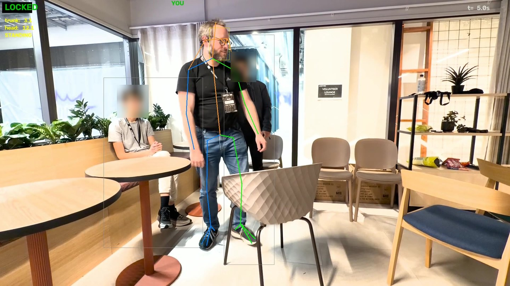

A real frame from the posture pipeline (`posture-analysis/`): RTMPose with foot keypoints, an InsightFace
identity lock and One-Euro smoothing. Only the enrolled person is measured ("LOCKED", "YOU"); everyone else
in the room is detected and ignored. Each frame gives a trunk angle, a head angle and a standing or seated
verdict, and the daily medians go to the data manager as one more channel against the person's own
baseline. Faces of the other people are blurred for this page.

The components, by folder:

- **Phone app** (`demo/` web layer, `ios/App`, `android/`): the morning session, the patient's week, the
  check-in, Talk, and "Show to my doctor". More in [docs/app.md](docs/app.md).
- **Sensor box** (`uno-q/modulino-hub`): an Arduino UNO Q. The STM32 samples the clips; the Linux side fuses
  them, advertises "Afferent Finger" over Bluetooth, serves `/state` on the mesh and pushes measured
  readings to the data manager.
- **Home hub** (`hub/`, deployed by `jetson/home_hub`): sessions, analytics, the week view, the shared
  dashboard, Talk transcripts and the daily wellbeing read. Every route except `/api/health` needs the hub
  token. [docs/home-hub.md](docs/home-hub.md).
- **Data manager** (`jetson/data_manager`): the SQLite store for every sensor.
- **Voice relay** (`voice-relay/`, Cloud Run): Talk and the locked dashboards.

[`STATUS.md`](STATUS.md) is the short list of what exists and the rules the code follows.

### Hardware

<table>
<tr>
<td width="230">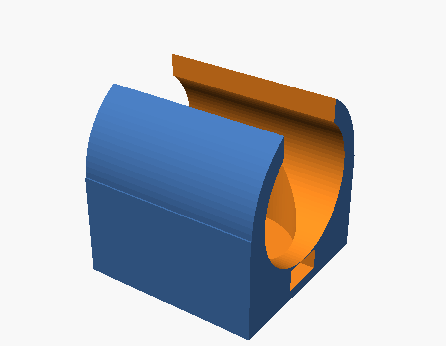</td>
<td>

- **Two finger clips:** PulseSensor-type optical sensors in 3D-printed fingertip holders (finger 1 on A1,
  finger 2 on A2), printed dark with high infill so room light cannot leak in. OpenSCAD source, S/M/L STLs
  and print notes in [`hardware/`](hardware/README.md).
- **Sensor box:** Arduino UNO Q with a Modulino Thermo (room temperature and humidity), a Modulino Buzzer
  and a KY-016 RGB LED (the "bedside light"). A Modulino Knob is supported but may be unplugged in the case.
- **Jetson Orin Nano** with one camera (Logitech C920), running the home hub, the data manager and the
  presence, posture and camera apps.
- **No sensor box?** Settings › Sensors › Sensor box off: sessions start at once and use the camera pulse,
  a watch or strap, or the labelled simulator.
- **No bed sensor.** The app's bed-presence switch is always off and never offered.

Minimal setup: about **€350** ([bill of materials](hardware/README.md)).

</td>
</tr>
</table>

## Run it

Needs Node 22+ and Python 3.12+. For the boards: the Wendy CLI
(`curl -fsSL https://install.wendy.dev/cli.sh | bash`, then `wendy auth login` with the team's org).

### Web demo in a browser

```sh
./start.sh --reset      # creates hub/.venv on first run, seeds the simulated demo roster
```

Then open the game at http://localhost:8000/app/, the patient view at `/app/patient.html?patient=anna` and
the clinic dashboard at `/clinic/`. Simulated sensors are on in the browser, so no hardware is needed.
`./start.sh --help` lists the options (a real UNO Q, no simulator, another port);
[docs/app.md](docs/app.md#the-demo-hub-and-developer-options) has the query options. An older snapshot of
the web app is hosted at https://afferent-demo.david-noel-vinu.workers.dev (not updated with every change).

<details>
<summary><b>iPhone</b></summary>


```sh
npm install
npm run sync            # copies design/ into demo/, writes demo/js/voice-config.js, runs cap sync
npm run open            # Xcode: pick the iPhone, set your signing team, Run
```

From the command line, with your own team and bundle id (the committed id is `fi.junction.afferent`; the
override is not saved in the project):

```sh
xcodebuild -project ios/App/App.xcodeproj -scheme App -configuration Debug \
  -destination 'platform=iOS,name=<your iPhone>' -derivedDataPath build/ios -allowProvisioningUpdates \
  DEVELOPMENT_TEAM=<team id> PRODUCT_BUNDLE_IDENTIFIER=<your.bundle.id> build
xcrun devicectl device install app --device '<your iPhone>' build/ios/Build/Products/Debug-iphoneos/App.app
```

The app needs iOS 17. Developer Mode must be on, and the first launch asks to trust the developer
certificate. `npm run sync` also writes the voice relay settings (below), so run it with those variables
set, or the build has no relay.

</details>

<details>
<summary><b>Android</b></summary>


With JDK 21 and the Android SDK on the path (Homebrew setup in [docs/app.md](docs/app.md#android)):

```sh
npm install
npm run build:android   # npm run sync, then ./gradlew assembleDebug
adb install -r android/app/build/outputs/apk/debug/app-debug.apk
```

`npm run open:android` opens Android Studio instead. CI (`.github/workflows/mobile-build.yml`) builds a
debug APK and an unsigned iOS simulator build on every pull request that touches the app.

</details>

<details>
<summary><b>Sensor box (UNO Q)</b></summary>


`wendy run` compiles and flashes the STM32 sketch, then deploys the Linux app. The data manager's address
and token go in with `--env` on every deploy and are never written to `wendy.json` or the repo:

```sh
cd uno-q/modulino-hub
read -s DATA_MANAGER_TOKEN        # paste the token; not shown, not in the shell history
wendy run --device <uno-q> --detach --yes \
  --env "DATA_MANAGER_URL=http://<data manager address>:8100" \
  --env "DATA_MANAGER_TOKEN=$DATA_MANAGER_TOKEN"
```

`GET /state` has a `data_manager` block to check that readings arrive (`last_error` `HTTP 401` = wrong
token). More in [`uno-q/SENSORS.md`](uno-q/SENSORS.md#readings-to-the-data-manager-on-the-jetson).

</details>

<details>
<summary><b>Home hub on the Jetson</b></summary>


The data manager already runs on the Jetson (mesh port 8100, token required); do not deploy a second copy.
Deploy the hub and pair:

```sh
WENDY_DEVICE=<jetson> jetson/home_hub/deploy.sh   # first deploy makes ~/.afferent/home-hub.token (mode 600)
wendy net forward 18000:18000 --device <jetson>  # keep running
jetson/home_hub/pair.sh                           # pairing link for a browser on this Mac
```

`deploy.sh` reads the data manager token from `~/.afferent/data-manager.token` (or
`AFFERENT_DATA_MANAGER_TOKEN`). The pairing link holds the hub token: open it, never paste it into a chat,
an issue or a commit.

For a phone on the same Wi-Fi as the Mac, keep the forward running and relay it on the Mac's Wi-Fi address:

```sh
IP=$(ipconfig getifaddr en0)      # the Mac's Wi-Fi address (en0 on most Macs)
socat TCP-LISTEN:8000,bind=$IP,fork,reuseaddr TCP:127.0.0.1:18000
jetson/home_hub/pair.sh $IP       # prints the Hub address; it must end in /k/<token>
```

In the app: Settings › Home hub › Paste, then Connect.

Without the Mac: the LAN door puts the hub on the Jetson's own Wi-Fi at port 8800 (the hub itself stays on
the mesh). With the Jetson on the phone's Wi-Fi:

```sh
WENDY_DEVICE=<jetson> jetson/home_hub/deploy.sh          # the hub announces itself on the mesh
WENDY_DEVICE=<jetson> jetson/home_hub/door/deploy.sh     # the door: port 8800, Bonjour _afferent-hub._tcp
WENDY_DEVICE=<jetson> jetson/home_hub/pair.sh --jetson   # Hub address <jetson-ip>:8800/k/<token>
```

In the app: Settings › Home hub › Find on this Wi-Fi (keeps the key it has), or Paste, then Connect.
Everything else (joining the Jetson to a Wi-Fi, networks that block Bonjour, USB hotspot instead of Wi-Fi,
the environment variables, real versus simulated patients) is in [docs/home-hub.md](docs/home-hub.md).

</details>

<details>
<summary><b>Voice relay</b></summary>


The app reads the relay's address and access code from `demo/js/voice-config.js`, which git ignores. Write
it from the environment, never into a committed file:

```sh
VOICE_RELAY_URL=https://<relay>.run.app VOICE_RELAY_CODE=<access code> npm run voiceconfig   # or npm run sync
```

Or type both on the phone: Talk › Start talking. To deploy the relay (Google Cloud project with billing,
`gcloud` signed in), from `voice-relay/`:

```sh
gcloud run deploy afferent-voice --source . --region europe-north1 \
  --service-account afferent-voice@<project>.iam.gserviceaccount.com \
  --allow-unauthenticated --timeout 3600 --min-instances 1 --max-instances 1 \
  --set-env-vars RELAY_CODE=<access code>,GOOGLE_CLOUD_PROJECT=<project>,VERTEX_LOCATION=us-central1
```

Exactly one instance, because shared dashboards are kept in memory. First-time setup (APIs, service
account) and the checks are in [`voice-relay/README.md`](voice-relay/README.md#deploy-once-10-min).

</details>

## Tests

```sh
# Web app and clinic page (node only; voiceconfig once, keyboard.test.js loads its output)
npm run voiceconfig
for f in demo/tests/*.test.js hub/tests/*.test.js; do node "$f" > /dev/null || echo "FAIL $f"; done
# Hub (start.sh makes hub/.venv; the dev requirements add zeroconf for the mDNS tests)
hub/.venv/bin/pip install -r hub/requirements-dev.txt
(cd hub && .venv/bin/python -m pytest -q)
(cd hub && .venv/bin/python -m afferent_hub.analytics.validate)   # synthetic validation, rewrites its results
# Sensor box and the Jetson apps
(cd uno-q/modulino-hub && python3 -m unittest discover tests)
(cd jetson/data_manager && python3 -m unittest discover -s tests)
(cd jetson/presence && python3 -m unittest discover -s tests)
(cd jetson/hub && python3 -m unittest discover tests)
# Voice relay (a fake Vertex, no Google account needed)
(cd voice-relay && pip install -r requirements-dev.txt && pytest test_main.py)   # pinned versions
# Native
(cd ios/App/TeamTests && swift test)     # camera pulse estimator and gate, screen light
(cd ios/App/FaceCore && swift test)      # face measures
(cd ios/App/FingerTests && swift test)   # Bluetooth packet parser
(cd android && ./gradlew testDebugUnitTest)
(cd fun/heart-duel && node --test)
```

The reference iPhone app has its own tests (`ios/README.md`). `posture-analysis/` and
`Transcription_analyzer/` document theirs in their READMEs.

## Repo layout

| Folder | What |
|---|---|
| `demo/` | the phone app's web layer (Capacitor web root): game, patient view, tests in `demo/tests` |
| `ios/` | `ios/App`: the Capacitor iOS app and its native plugins; `ios/Afferent`: the native reference app |
| `android/` | the Capacitor Android app and its native plugins |
| `hub/` | FastAPI hub: API, analytics, clinic dashboard, bedside link, handover export |
| `jetson/` | Wendy apps for the Jetson: `home_hub` (deploys `hub/`), `data_manager`, `presence`, `vision`, `hub` |
| `uno-q/` | the sensor box app `modulino-hub` (STM32 sketch + Linux side) and `SENSORS.md` |
| `voice-relay/` | Cloud Run relay for Talk and the locked dashboards, with the doctor's viewer |
| `contracts/` | JSON schemas and fixtures shared by the app and the hub |
| `design/` | design tokens, fonts, icon and the final concept art |
| `art/` | the plans for the generated images and music (`generate.py`, `plan.json`, `music_plan.json`) |
| `hardware/` | printable finger clip holders and the bill of materials |
| `posture-analysis/` | posture, gait and expressivity markers from a camera, its controller and training |
| `Transcription_analyzer/` | speech-drift scoring of Talk transcripts |
| `fun/` | Heart Duel for the Mac |
| `tools/` | helper scripts: music import, clinic demo exports |
| `docs/` | longer write-ups (below); `docs/img/` holds this page's screenshots and diagrams |
| `bibliography/` | references for the posture and expression work |

All repo content (code, comments, docs, commit messages) is in English.

## Further reading

- [docs/app.md](docs/app.md): sensors in the app, camera pulse, face measures, clip check, room climate,
  Android, developer options. [docs/handover.md](docs/handover.md): "Show to my doctor".
- [docs/home-hub.md](docs/home-hub.md): the hub on the Jetson, transcripts, the wellbeing read;
  [docs/decline_alert.md](docs/decline_alert.md): the personal decline alert.
- [docs/boards.md](docs/boards.md): the boards, the Jetson camera app, the patient's own health-data hub
  (`jetson/hub`), the reference iPhone app. [`uno-q/SENSORS.md`](uno-q/SENSORS.md): the sensor box's API.
- [`BUG_BURN_DOWN.md`](BUG_BURN_DOWN.md) and `docs/bugburn/`: the bug audit. The posture and expression work:
  [plan](docs/plan_posture_depression.md), [capture](docs/capture_plan.md),
  [review](docs/implementation_review.md), [training](docs/verda_training.md).

## Licenses and credits

- Code: [MIT](LICENSE). Sounds in `demo/audio/`: CC0 and public-domain recordings, each with source,
  author and changes in [`demo/audio/CREDITS.md`](demo/audio/CREDITS.md).
- Images and music tracks were generated for this project; the plans are in `art/` (the walk's
  birches and spruces in `art/plan.json`, finalised by `art/finalize_trees.py`; the earlier image plans on
  branch `art-v5`), and `tools/music_import.py` cuts and normalises the tracks.
- Fonts: Fraunces, Google Sans Flex, Jost and JetBrains Mono (SIL Open Font License; texts in
  `design/fonts/` and `demo/fonts/`), Material Symbols (Apache-2.0).
- Vendored: qrcode-generator, jsQR, fflate, noble-curves/hashes
  ([`demo/vendor/qr/LICENSES.md`](demo/vendor/qr/LICENSES.md)); MediaPipe Tasks Vision and its face
  landmarker model (Apache-2.0, [`demo/vendor/mediapipe/LICENSE`](demo/vendor/mediapipe/LICENSE)).
- The companion's listening design draws on Rogers and Farson
  ([references](voice-relay/README.md#listening-design-and-references)).
