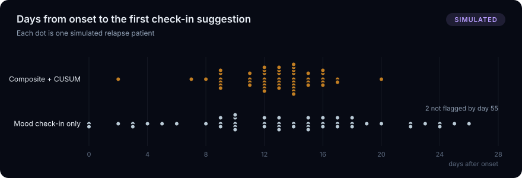
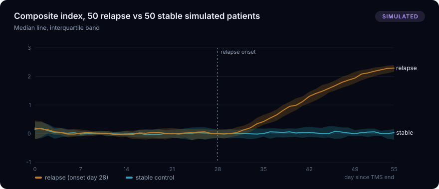
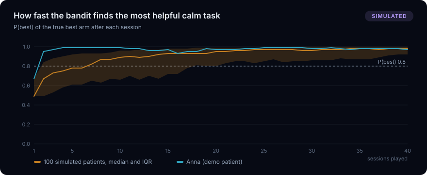
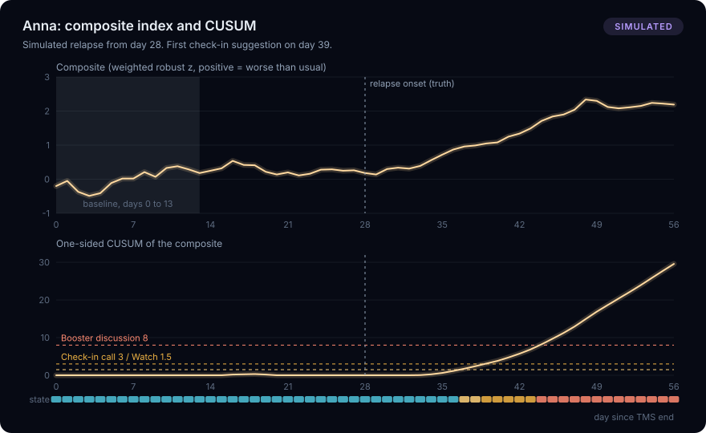
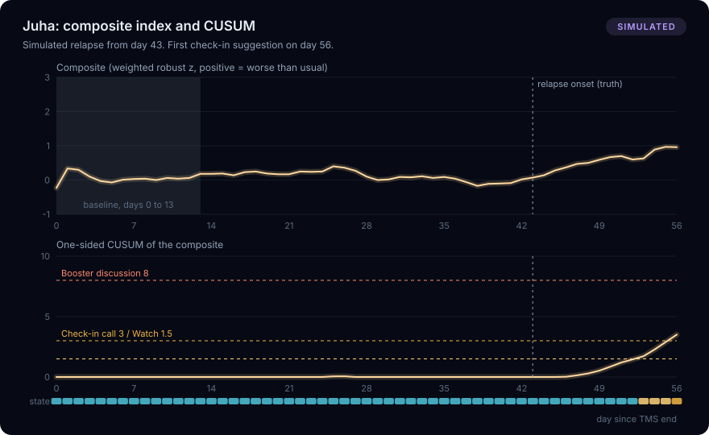
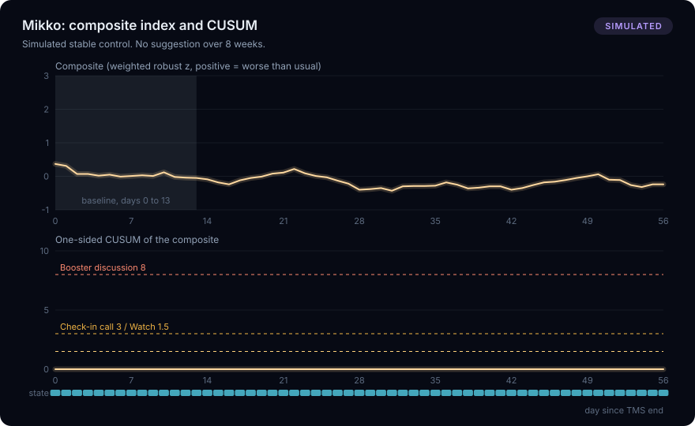

# Validation on synthetic data

**SIMULATED. Every number on this page comes from our own synthetic generator (`hub/afferent_hub/synthetic.py`), not from patients.** The parameters were set on this same synthetic data and were never tuned on real patient data. Nothing here is clinically validated. The detector and the generator were written by the same team, so the generator shares the detector's assumptions; real data will have more non-stationarity, more missingness patterns and smaller, less consistent changes, so expect longer lead times and more false alarms in practice.

Reproduce: `cd hub && .venv/bin/python -m afferent_hub.analytics.validate` (writes this file, `docs/validation/*.svg` and `hub/afferent_hub/analytics/validation_results.json`, which `GET /api/validation` serves). Generated 2026-11-14T05:08:28+02:00, 50 seeds.

## What was simulated

For each seed, one relapse patient and one stable control, 56 days each (days 0 to 55 after the end of TMS), with personal baselines drawn per patient, day-to-day noise, a shared slow "day quality" factor, weekends (later sleep, more home-only days), about 10 to 15% missed days at baseline, about 3% declined days, sensor dropouts (presence sensor about 4% of nights, phone presence about 5% of days, pulse quality below 0.5 in about 7% of sessions, face not tracked in about 4%), morning pulse readings missing on about 25% of days, a reaction-time practice effect in the first week, and occasional partial sessions.

- Relapse: severity ramps linearly from 0 on day 28 (week 5) to 1 on day 49. At full severity: reaction time about +80 ms, mood check-in about 2 lanterns lower, sleep timing more irregular (lower inter-daily stability), wake time later, more naps, more home-only days, more missed sessions, fewer hard choices at the fork, a weaker reward bias in Two lanterns, less upright time and a morning resting pulse about 6 bpm higher.
- Stable control: no relapse, but about half of them get a short simulated rough patch (4 to 8 days at up to 30% severity), so the false-alarm numbers are not trivially zero by construction.
- Bandit: every patient has true per-task "helped" rates (calm: Breath about 0.75, Löyly at least 0.2 lower; wake and fatigue arms closer together and varying by patient). The simulated game picks tasks with the Thompson-sampling weights computed from that patient's earlier sessions, so this is a closed loop.

The analytics engine (`analyze_patient`) is run day by day (`now_day` = 14 to 55), seeing only data up to that day.

## Parameters used

EWMA lambda 0.3, CUSUM from day 14 with k = 0.35, thresholds watch 1.5, check-in 3, booster 8. Composite features, weights and MAD floors:

| Feature | Weight | MAD floor | Evidence |
|---|---|---|---|
| Reaction time | 1.5 | 20 (ms) | established |
| Mood check-in | 1.5 | 1 (lantern 1-5) | established |
| Sleep regularity | 1 | 0.05 (IS 0-1) | plausible |
| Missed sessions (7 d) | 1 | 1 (days) | plausible |
| Effort choice (7 sessions) | 1 | 0.2 (share hard) | plausible |
| Morning resting pulse | 0.75 | 2 (bpm) | plausible |
| Home-only days (7 d) | 0.75 | 1 (days) | plausible |
| Upright time in play | 0.5 | 0.05 (share) | exploratory |
| Reward bias log b (7 sessions) | 0.5 | 0.15 (log b) | exploratory |

Changes from the first contract draft (logged in `Statistics.md`): k lowered from 0.5 to 0.35, and the MAD floors of mood (0.5 to 1 lantern), missed sessions and home-only days (0.75 to 1 day), effort (0.15 to 0.2) and reward bias (0.1 to 0.15) raised. The windowed features are strongly autocorrelated inside the 14-day baseline, so their raw MAD underestimates their real day-to-day spread and inflated the z-scores of stable patients.

## Results

### Early warning on relapse patients (50 simulated)

| Measure | Result |
|---|---|
| Days from onset to first "watch" | 11 days (IQR 9 to 12, n = 50) |
| Days from onset to first "consider a check-in call" (lead time) | 13 days (IQR 11.2 to 14, n = 50) |
| Days from onset to first "consider discussing a booster session" | 18 days (IQR 16 to 19, n = 50) |
| Relapses flagged with a check-in by day 55 | 100% |
| Relapse patients flagged before onset (days 14 to 27) | 0% |
| Mood check-in alone (same CUSUM on the mood feature only), days to flag | 13.5 days (IQR 9.8 to 17.2, n = 48), flagged 96% |
| Lead of the composite over mood alone | 1 day (IQR -3 to 4, n = 48) (only seeds where both rules flagged by day 55) |
| Mood alone with its threshold raised until its false alarms on stable controls match the composite (3 episodes, threshold 7.5) | 18 days (IQR 15 to 20.5, n = 43), flagged 86% |

Reading: at the same CUSUM settings the composite flags a median of 1 day earlier than the mood check-in alone, but mood alone raises 15 false check-in suggestions on the stable controls against 3 for the composite. Held to the same false-alarm count, mood alone flags a median of 18 days after onset and catches 86%, against 13 days and 100% for the composite. In this simulation, combining signals mainly buys specificity (fewer unnecessary calls for the clinic, and no suggestion that rests on one self-report item); at an equal false-alarm count that specificity turns into earlier and more complete detection.

Severity reaches 1 on day 49, so a check-in suggestion about 13 days after onset arrives while the simulated relapse is still building.

### False alarms on stable controls

| Measure | Result |
|---|---|
| Stable patients, patient-days (days 14 to 55) | 50, 2100 |
| False "check-in" episodes | 3 (0.043 per patient-month) |
| False "watch" episodes | 6 |
| False "booster" episodes | 0 |
| Stable patients with any check-in suggestion | 6% |
| Mood-only rule, false check-in episodes | 15 |

### Sensitivity (lead time against false alarms)

| CUSUM k | Check-in threshold | Days onset to check-in | Flagged by day 55 | False check-ins per patient-month |
|---|---|---|---|---|
| 0.25 | 2 | 11 days (IQR 9 to 12, n = 50) | 100% | 0.129 |
| 0.25 | 3 | 12 days (IQR 11 to 13, n = 50) | 100% | 0.086 |
| 0.25 | 4 | 13.5 days (IQR 12 to 14.8, n = 50) | 100% | 0.057 |
| 0.35 | 2 | 12 days (IQR 10 to 13, n = 50) | 100% | 0.071 |
| 0.35 | 3 | 13 days (IQR 11.2 to 14, n = 50) | 100% | 0.043 | current
| 0.35 | 4 | 14 days (IQR 12.2 to 16, n = 50) | 100% | 0.043 |
| 0.5 | 2 | 13 days (IQR 11.2 to 15, n = 50) | 100% | 0.043 |
| 0.5 | 3 | 14 days (IQR 13 to 16, n = 50) | 100% | 0.014 |
| 0.5 | 4 | 16 days (IQR 14 to 17, n = 50) | 100% | 0.000 |

### What works for this person (bandit)

Sessions until the bandit's P(best) for the truly most helpful task first reaches 0.8, over 100 simulated patients (relapse and stable). "Pick share" is how often the director actually chose the true best task in that mode, early and late: Thompson sampling shifts the choice towards what helps while still exploring.

| Mode | Sessions to P(best) >= 0.8 | Reached by day 56 | Pick share days 0 to 13 | Pick share days 42 to 55 |
|---|---|---|---|---|
| calm | 4 sessions (IQR 2 to 10, n = 97) | 97% | 60% | 74% |
| wake | 15 sessions (IQR 10 to 23, n = 49) | 49% | 41% | 53% |
| fatigue | 23 sessions (IQR 15 to 33, n = 41) | 41% | 36% | 53% |

Calm has one clearly better task (Breath), so it converges fast. Wake and fatigue tasks are closer together, so the posterior often stays uncertain over 8 weeks; the dashboard shows that uncertainty instead of a false winner.

## Demo patients

The six demo patients use fixed seeds that were picked so the roster tells the intended story (Anna: relapse from day 28, check-in suggestion on day 39; Juha: relapse from day 43, check-in suggestion on day 56; Mikko, Leena, Sofia and Eero stable). That pick is a presentation choice; the numbers above use 50 unpicked seeds.

## Limits

- Simulated, in-sample, not clinically validated. The relapse effect sizes are our assumptions, not measured values.
- The comparison rule (mood alone) uses the same detector; it is not a validated clinical instrument such as a PHQ-9 schedule.
- The bandit outcome ("pulse moved 2 bpm in the intended direction") is a within-session proxy. It says nothing about longer-term benefit; the next-day associations on the dashboard are associations, not causation.
- The system only suggests. A clinician decides.
